# PROTITIC HAND

A low-cost, durable, open-source prosthetic hand for people missing two phalanges on each finger.

  

🔗 **CAD (Onshape):** <ADD CAD LINK HERE>
📐 **Kinematics model (Desmos):** https://www.desmos.com/calculator/bnfynyphme

> ⚠️ Read the [safety notice](SAFETY.md) before building or using this device. See also the [patent notice](PATENTS.md).

## About

The goal of this project is to create a low-cost, durable, open-source prosthetic hand for people missing two phalanges on each finger. We have already incorporated all six main grasp types (tip, hook, palmar, spherical, lateral, and cylindrical), which served as the primary stepping stones for the project. But there is still much progress to be made to make it more practical, reliable, and easier to repair/construct.

At the time of writing, there is no open-source prosthetic hand for people missing two phalanges. Buying one is for the few: commercial prosthetic fingers can cost around R$100,000 each, and they need to be replaced every 3 years. The primary purpose of the project is to make something open source, so that anyone can download, adapt, and improve it, greatly expanding who can benefit from it.

Building a device that Claudia can use to help grab objects was already incredibly rewarding. But we haven't stopped. Our goal is to make a device that actually benefits people in their daily lives, and hopefully the project continues with another student, online, continually improving the design.

## Design

Fully mechanical, fully rigid, reliable, durable, and simple in appearance. The main priority is functionality. The CAD is parametric, so the finger can be rescaled to each person's measurements.

  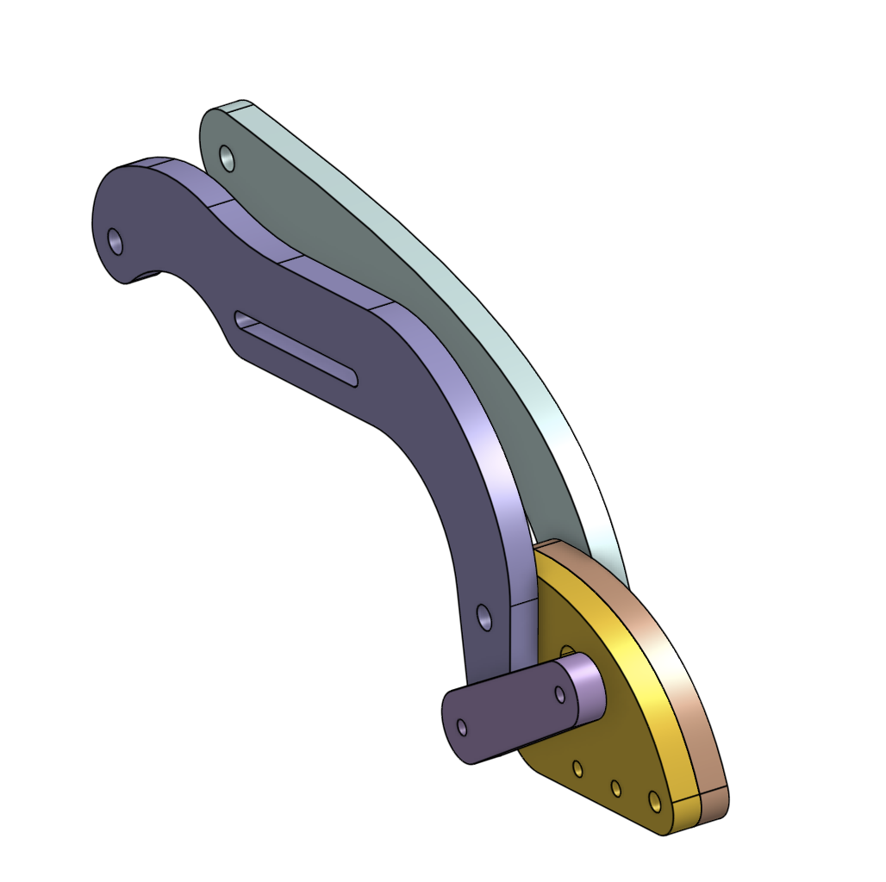
  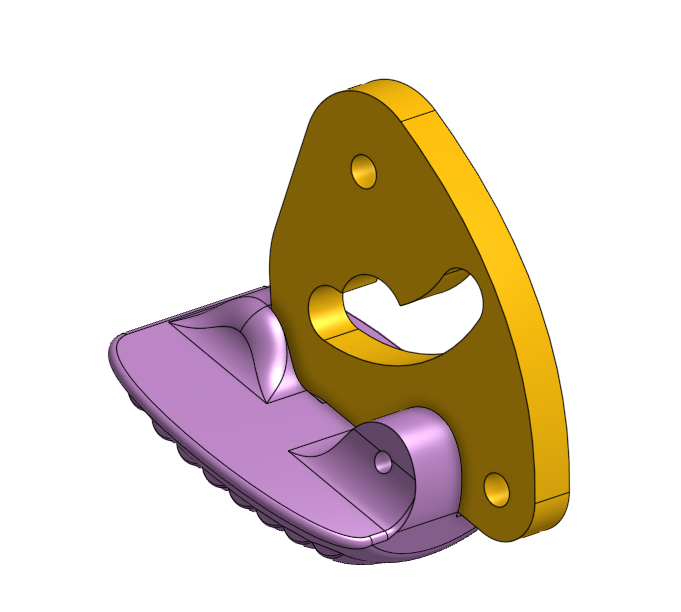
  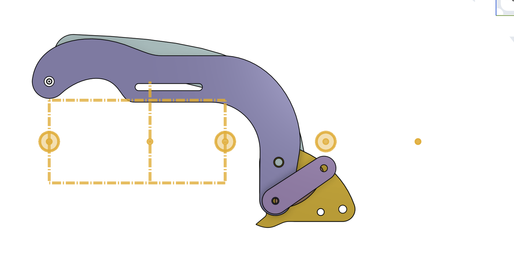

  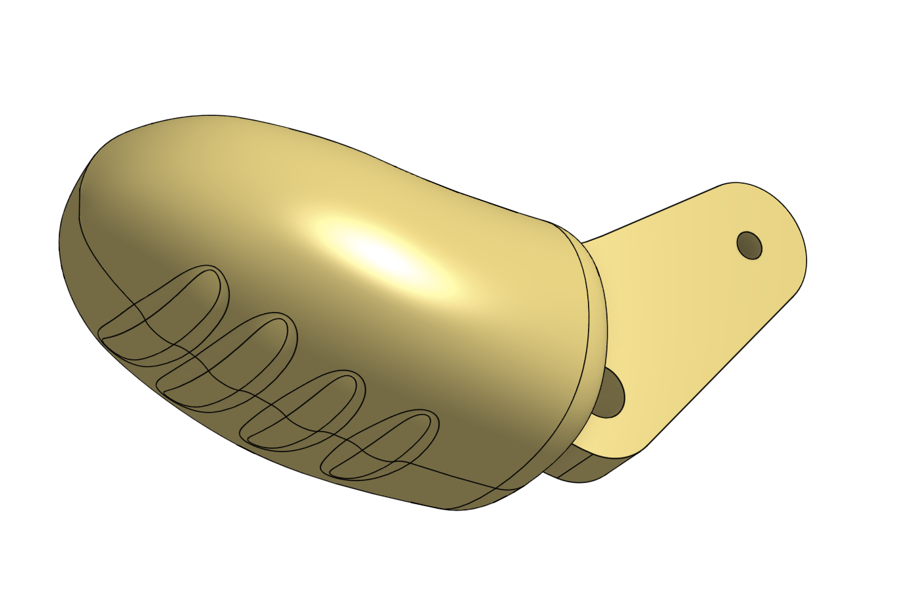
  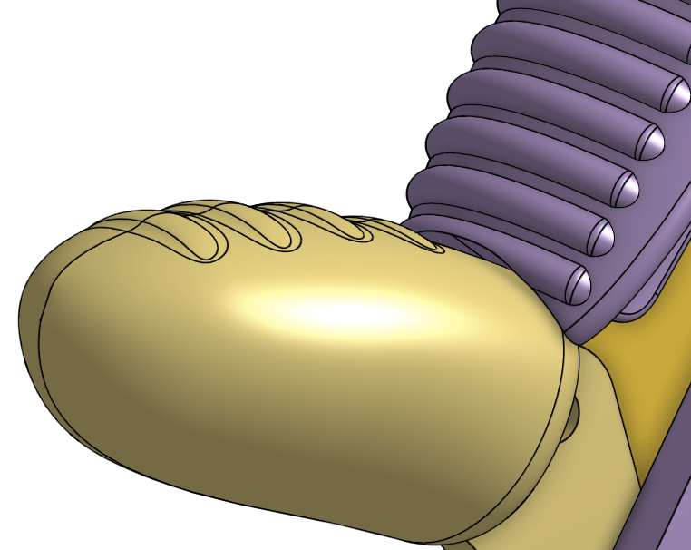
  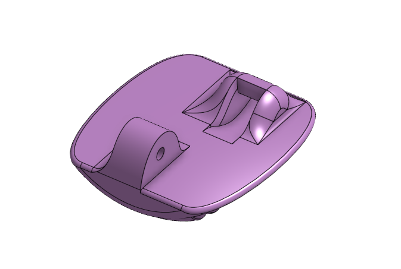

**Attachment.** The device is attached to the residual finger and the back of the hand.

  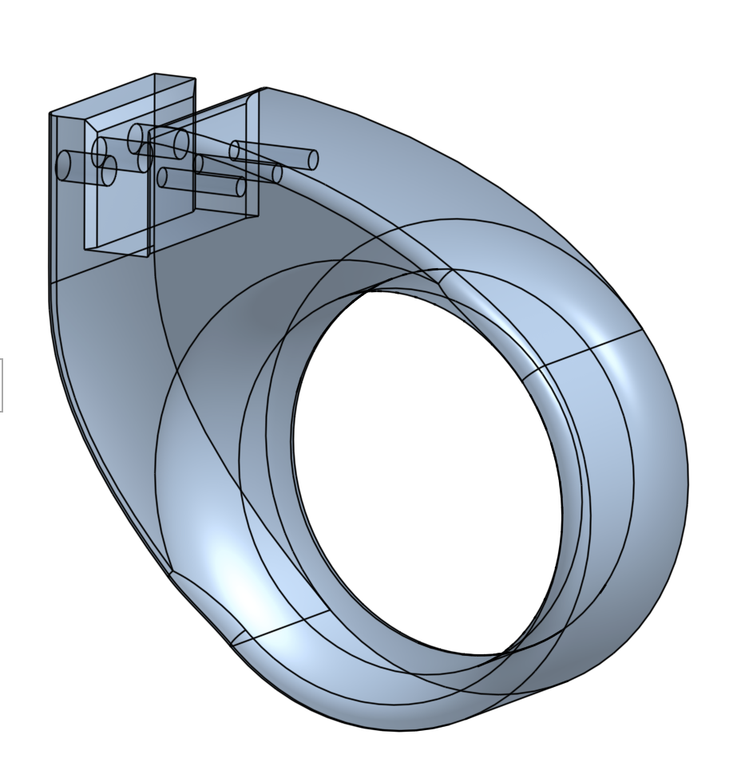
  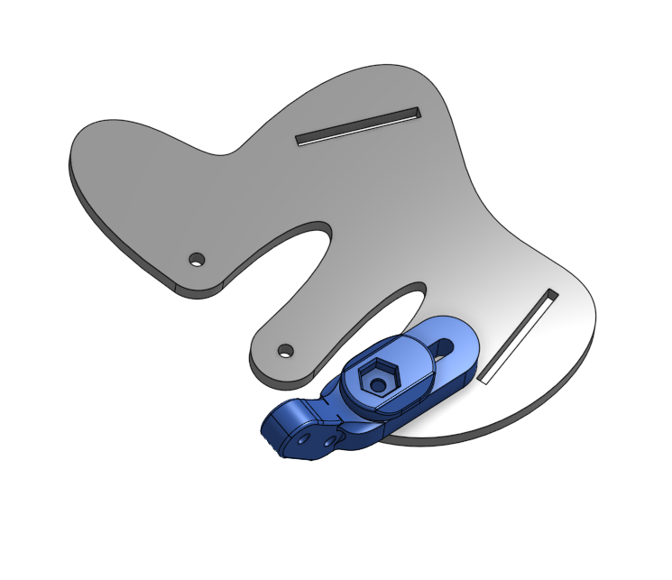

**Grip.** Textured pads for better grip, with molds for an optional silicone version.

  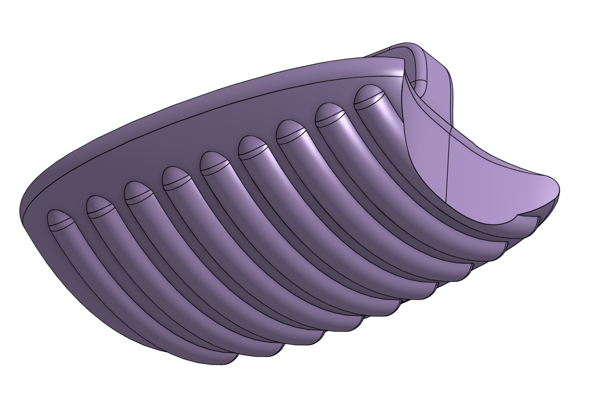
  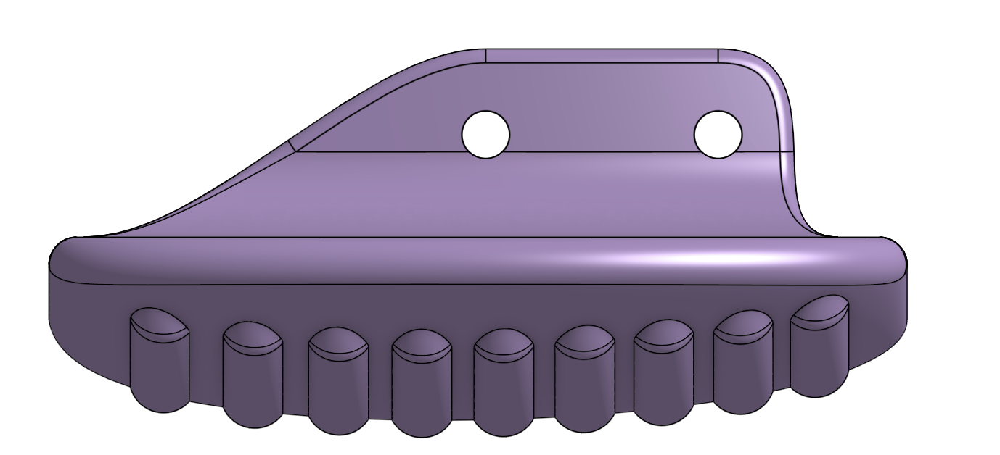
  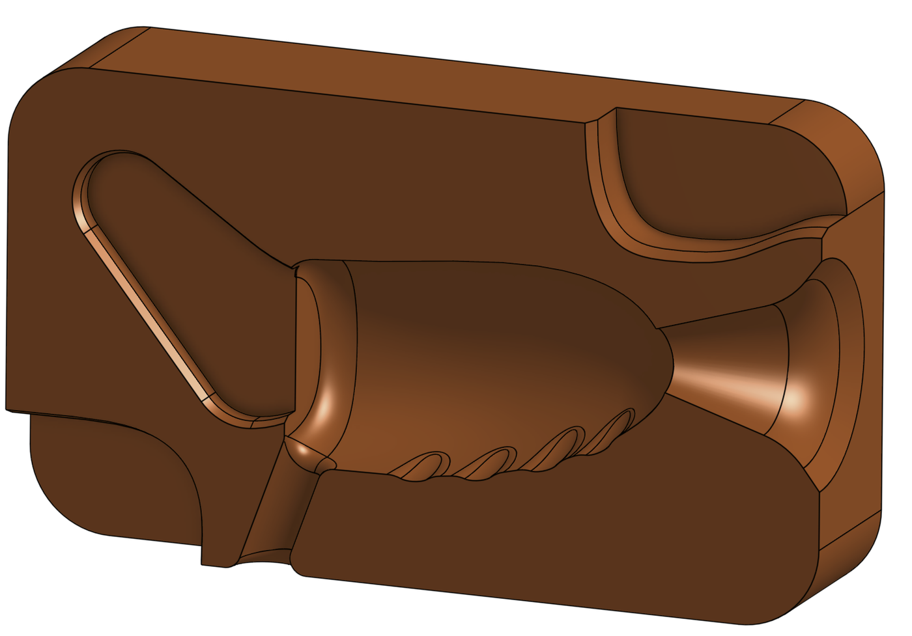
  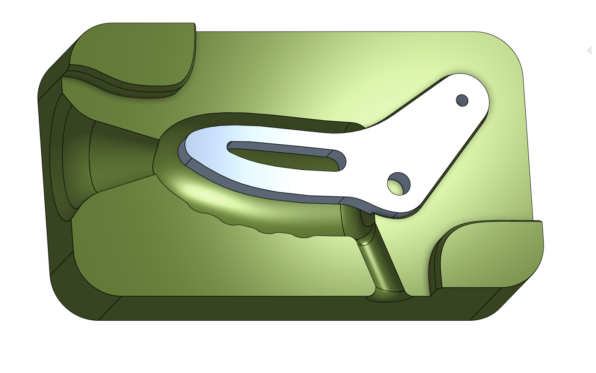

## Movement

The joint angles were documented on a real hand and modelled with trigonometry, so the finger moves as close as possible to a natural one. Typical proportions used: proximal : middle : distal ≈ 2 : 1.2 : 1.

  
  
  

  

## Testing

Dozens of prototypes, tested on a real hand. Acrylic handled stress much better than MDF.

  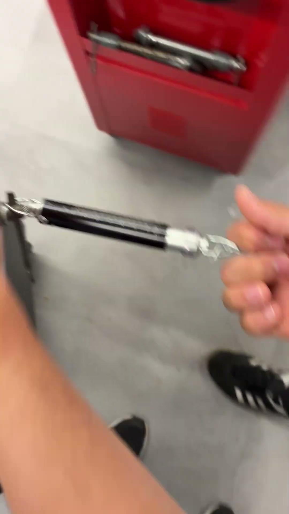
  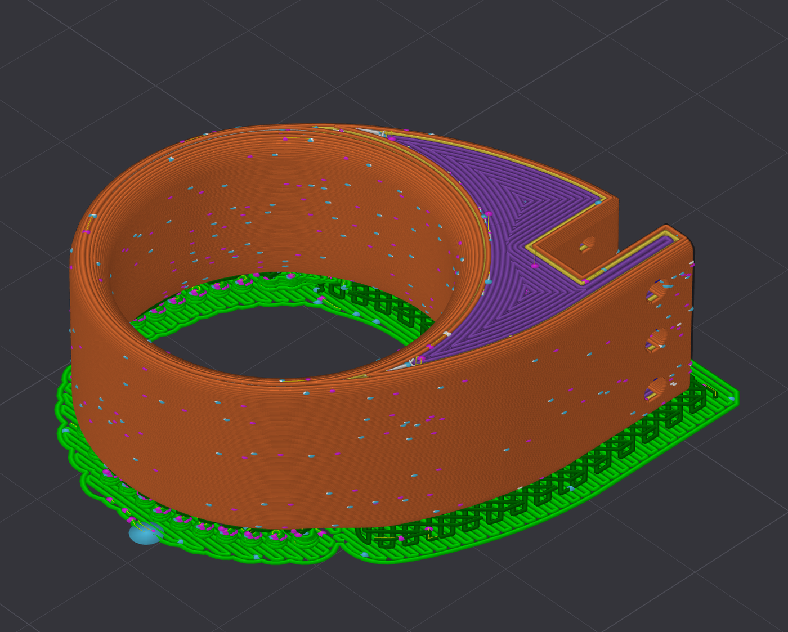

## Why it matters

Being able to grab objects safely and reliably changes what someone can do at home, at work, and in public. And unlike one-off inventions that help only a single person, an affordable open-source prosthesis can be replicated and improved anywhere in the world.

For our learning, we're applying trigonometry and mechanics to a real human hand, iterating through dozens of prototypes, and working directly with a patient (Claudia), translating her needs about comfort, durability, and repairability into engineering decisions.

## License

[CC0 1.0](LICENSE): free to use, copy, modify, and sell for any purpose. No credit needed.
